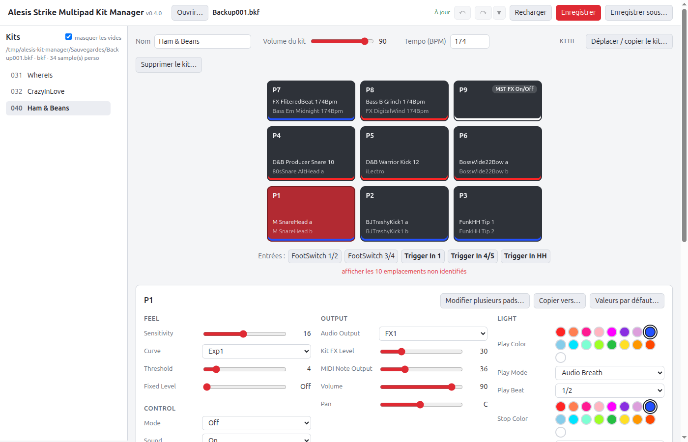

# Alesis Strike MultiPad - Kit Manager

**English** · [Français](README.fr.md)

Tools for creating and editing the Alesis Strike MultiPad "user kits" on a
computer, from its USB backups:

- `.bkf`: *Save All User Kits* (`Strike/All User Kit And Sample Backup/`): user kits and samples;
- `.fac`: `Strike/BackUp/…/STRIKE_BACKUP_KIT.fac`: kits only.

The format is not documented by Alesis: it was reverse-engineered. **Keep a
copy of the original backup** before loading a file produced by these tools.



## Commands

| Command | Purpose |
|---|---|
| `python3 -m strike_kits export BACKUP FOLDER [--no-wav]` | exports the kits as JSON and the user samples as WAV |
| `python3 -m strike_kits import BACKUP FOLDER -o NEW` | applies the JSON files and the new WAVs, writes a new backup |
| `./dev.sh serve BACKUP` | starts the editor in the browser on this backup (quick start) |
| `./dev.sh start [--frozen] [BACKUP]` | starts the desktop app (Electron), in development |
| `./dev.sh package` | builds the desktop app's .deb package (`sudo apt install ./desktop/dist/alesis-kit-manager_*.deb`) |
| `./dev.sh release X.Y.Z` | new release: versions updated, commit and tag `vX.Y.Z` (not pushed) |

`strike_kits` only needs Python 3. `./dev.sh serve` and `./dev.sh start`
also require Node.js: on first run, they create the `.venv` virtual
environment, install the dependencies and build the interface; after that,
they only redo what has changed.

## Example

```bash
python3 -m strike_kits export Backup001.bkf my_kits
# edit my_kits/kits/032_Empty.json, drop WAVs into my_kits/wav/
python3 -m strike_kits import Backup001.bkf my_kits -o Backup002.bkf
```

## Documentation

| Guide | Contents |
|---|---|
| [Editing a kit](docs/en/editing-a-kit.md) | from the backup on the device to reloading it, through the JSON files |
| [Adding a sample](docs/en/adding-a-sample.md) | required format, `wav/` folder, rules and limits |
| [Web editor](docs/en/web-editor.md) | installation, launch, usage, API |
| [Desktop app](docs/en/desktop-app.md) | launch, how it works, troubleshooting |
| [Export contents](docs/en/export-contents.md) | `kits/*.json`, `samples.json`, `wav/` |
| [Parameters](docs/en/parameters.md) | meaning and range of each field, and a method for identifying more |
| [Known limitations](docs/en/limitations.md) | what is not yet covered or verified |
| [Development](docs/en/development.md) | code layout, tests, reference backups |

Binary formats:

- [docs/en/bkf-format.md](docs/en/bkf-format.md): `.bkf` container, samples, index lists and kit format;
- [docs/en/fac-format.md](docs/en/fac-format.md): `.fac` container.

Release history: [CHANGELOG.md](CHANGELOG.md).
