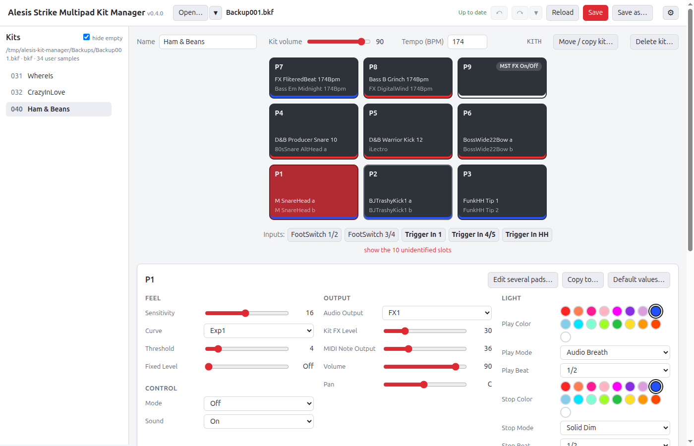
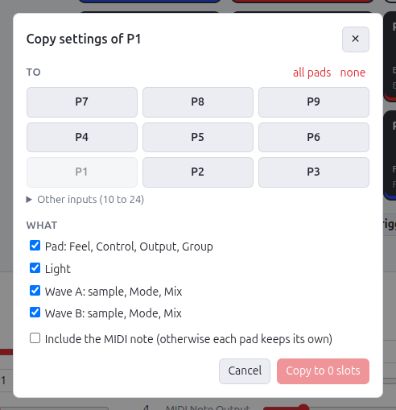
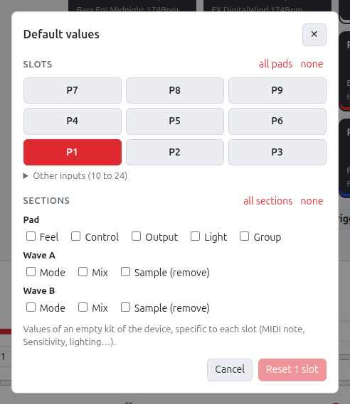
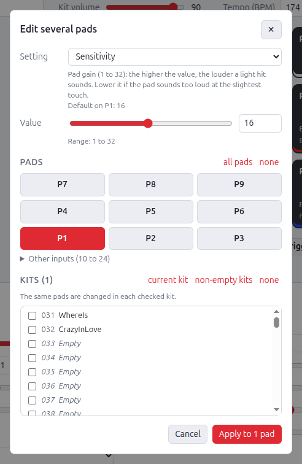
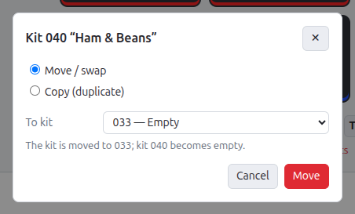
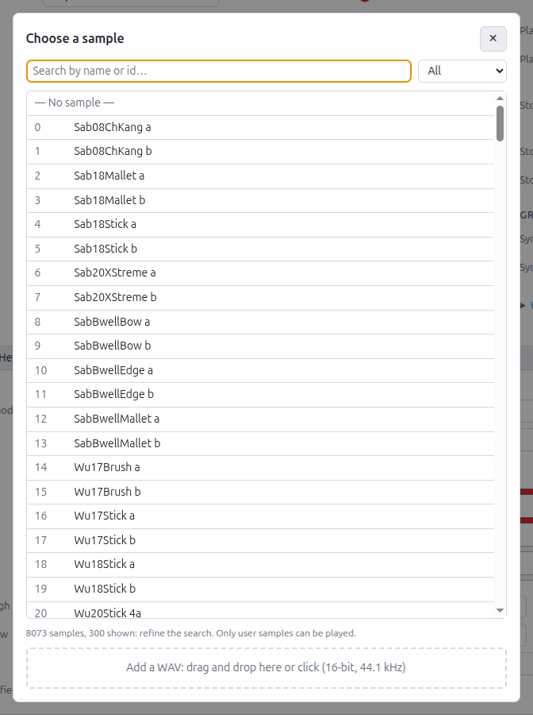
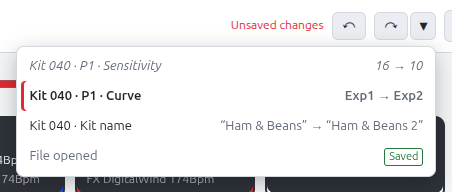
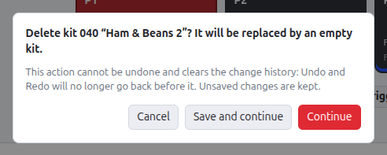
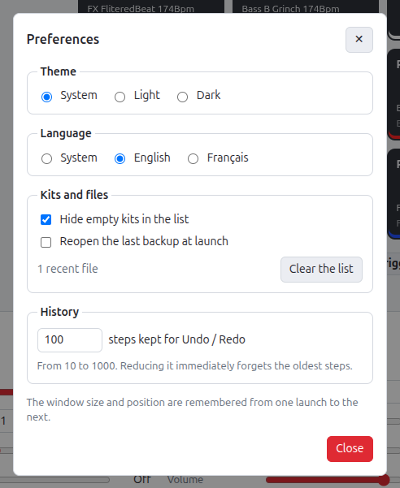

# Web editor

**English** · [Français](../fr/web-editor.md)

Local graphical interface (FastAPI + Svelte) for editing kits without handling
JSON.

## Launch

Requirements: Python 3 and Node.js (tested with Python 3.14 and Node.js 25).

```bash
./dev.sh serve Backups/Backup001.bkf
```

`./dev.sh serve` is the **quick start in the browser**, without Electron: the
editor runs there in the same mode as the desktop app (token, files referenced
by absolute path). The `.bkf` or `.fac` backup to open is required; its path is
relative to the current folder.

The command sets up whatever is missing, then starts the server:

1. creates the `.venv` virtual environment if it does not exist;
2. installs the dependencies from `requirements-dev.txt` (editor, tests, tools),
   then reinstalls them whenever this file or `requirements.txt` changes;
3. installs the interface packages (`npm ci`) and builds it into
   `editor/web/dist`, then rebuilds it whenever a source file in
   `editor/web/` is modified;
4. runs `python -m editor --open FILE` with the options it received.

`./dev.sh start` does the same setup for the desktop app.

Useful variables: `PYTHON=python3.12` selects the interpreter that creates the venv, and
`REBUILD=1` forces the interface to be rebuilt. The `.bkf` and `.fac` files in the
project's `Backups/` folder are ignored by Git.

| Option | Purpose | Default |
|---|---|---|
| `--port N` | HTTP port (`0`: a free port is chosen) | 8765 |
| `--host ADDRESS` | listening address | 127.0.0.1 |
| `--no-browser` | do not open the browser | — |
| `--allow FOLDER` | folder allowed in addition to the [default area](#allowed-folders) (repeatable) | — |
| `--watch-stdin` | stop when standard input closes (used by the desktop app) | — |
| `--version` | print the version (`alesis-kit-manager-server X.Y.Z`) and exit | — |

The browser opens at the displayed address, of the form
`http://127.0.0.1:8765/#token=…`. The server only listens on the local machine and
`Ctrl+C` stops it.

### Allowed folders

The server only opens and saves backups in:

- the user's home folder;
- their removable media (USB stick, Strike connected over USB): on Linux
  `/media/<user>` and `/run/media/<user>`, on macOS `/Volumes`,
  on Windows every drive except the system drive (`D:\`, `E:\`…, even
  when connected after launch);
- the folders added with `--allow FOLDER` (`./dev.sh serve FILE --allow FOLDER`).

Paths are resolved before the check: a symbolic link placed in the home folder
cannot be used to reach a file outside it. A path outside these folders is
refused (error 403, “outside the allowed folders”);
so is the backup passed at launch, in which case the server exits with code 2.
Since the `.bak` copy is written next to the open file, it stays within the area.
The desktop app uses the default area.

### Token

Every `/api/*` request must carry the `X-KitManager-Token` header with the token
of the current launch, otherwise it receives a 403 error: another program on the
machine therefore cannot drive the editor, which reads and writes files.

- **Local launch**: a token is created at each launch and passed to the
  browser in the address (`#token=…`). The interface keeps it for the tab, which
  allows the page to be reloaded, and removes it from the displayed address. A page
  opened without it shows “Access denied”.
- **Electron app**: the token is given by the `KITMANAGER_TOKEN` environment
  variable. Once listening, the server then writes a `{"ready": true, "port": N}`
  line to its standard output, useful with `--port 0`.

```bash
KITMANAGER_TOKEN=$(openssl rand -hex 16) .venv/bin/python -m editor --port 0 --open "$PWD/Backups/Backup001.bkf"
```

Without `dev.sh`, the manual installation is as follows:

```bash
python3 -m venv .venv && .venv/bin/pip install -r requirements.txt
cd editor/web && npm ci && npm run build && cd ../..
.venv/bin/python -m editor --open Backups/Backup001.bkf
```

## Usage



1. **Open**: the backup passed at launch is already open. To open another
   one, enter its full path at the top, then click *Open*.
   In the desktop app, *Open…* and *Save as…* use the
   system dialogs, and only the name of the open file is displayed.
   The ▾ chevron next to it lists the last 10 files opened or saved; in the
   browser, the field suggests the most recent one at launch.
2. **Choose a kit** in the left column (empty kits are hidden by default; uncheck *hide empty* to see them, for example to drop a kit onto one; this choice is remembered, see [Preferences](#preferences)).
3. **Set up the kit**: name, volume, tempo.
4. **Choose a pad** in the grid of 9 pads, laid out as on the device (7-8-9 at the top,
   4-5-6 in the middle, 1-2-3 at the bottom). It shows the sample, the LED color and,
   if the pad has a Mode (Control), a badge ("Click" for Click On/Off). Below the grid
   are the identified rear inputs (FootSwitch 1/2, FootSwitch 3/4, Trigger In 1,
   4/5, HH, in that order); the other slots (10 to 24) are shown through the
   *show the unidentified slots* link.
5. **Set up the pad**:
   - pad sections, as on the device: *Feel* (Sensitivity, Curve, Threshold,
     Fixed Level), *Control* (Mode, Sound), *Output* (Audio Output, Kit FX Level,
     MIDI Note Output, Volume, Pan), *Light* (color, mode and beat Play / Stop),
     *Group* (Sync Group, Sync Mode); unidentified parameters are grouped separately;
   - *Wave A / Wave B*: sample, then *Mode* (Playback Mode, Poly/Mono) and *Mix*
     (Volume, Pan, Fade In/Out, Velocity High/Low, Priority).

   Hovering over the name of a setting shows its description, taken from the manual, and its
   default value for the displayed pad. This value was read from an empty kit
   written by the device, and varies for some settings: MIDI note specific to each
   slot, Sensitivity at 16 on P1–P6 but 24 on the small pads P7–P9. For
   an unidentified parameter, the tooltip also gives its range and, where applicable,
   a lead.
6. **Copy a pad**: *Copy to…* (at the top of the pad settings) copies its
   settings to one or more other slots. You choose the sections (pad,
   lighting, wave A, wave B) and whether the MIDI note follows; by default, each pad keeps
   its own. A field missing from the target is not copied and is listed in the
   confirmation message.

   

   *Default values…* (next to it) resets settings to the values of an empty kit
   from the device, specific to each slot (MIDI note, Sensitivity, lighting…).
   You choose the slots (the displayed pad is preselected) and the
   sections: Feel, Control, Output, Light and Group for the pad, Mode and Mix for
   each wave, *Sample (remove)* to also remove the sample. No section
   is checked initially; *all sections* checks them all, except
   sample removal.
   Unidentified parameters are left untouched.

   

7. **Edit several pads**: *Edit several pads…* (at the top of the
   pad settings) gives the same value to a setting on a selection of pads, for
   example Sensitivity = 20 on P1, P3, P5 and P9. You choose the setting (pad,
   lighting, velocity or mix of a wave), the value, bounded by its range, then
   the pads. The suggested value is that of the current pad. The *Kits* section
   applies the same value to the **same pads in several kits** (current kit
   checked by default, *non-empty kits* shortcut). The operation is all or nothing:
   if one kit rejects the value, none is modified.

   

8. **Move or duplicate a kit**: *Move / copy kit…* (next to the tempo)
   - *Move / swap*: the kit goes to the chosen number. If that kit is empty, it is
     a move (the original number becomes empty); otherwise the two kits are
     swapped;
   - *Copy (duplicate)*: a copy of the kit replaces the chosen kit, after
     confirmation if that one is not empty.

   A kit does not contain its own number: the operation copies its bytes as
   they are, samples and settings included.

   In the kit list, the ⠿ handle at the end of the row (visible when hovering over a
   non-empty kit) also allows **reordering by drag and drop**: the kit
   takes the place of the kit it is dropped on (a line shows where), and the kits
   in between shift by one position, as in a list.

   

   *Delete kit…* (next to it) replaces the kit, after confirmation, with the empty
   kit written by the device: name "Empty", volume 100, 120 BPM, default
   settings, no sample. User samples remain in the backup. The
   button is grayed out on a kit that is already empty.
9. **Choose a sample**: the sample button opens a window for searching by name
   or by id, with a *My samples / Factory* filter. The ▶ button plays a user
   sample. The bottom area adds a WAV by drag and drop
   (see [Adding a sample](adding-a-sample.md)).

   

10. ***Save*** writes to the open file. On the first save of
   each session to an original file, its previous state is copied to
   `<file>.N.bak` (`Backup001.bkf.1.bak`, then `.2.bak` in the next session):
   nothing is lost. ***Save as*** writes to another file (the next
   name is suggested, `Backup003.bkf` after `Backup002.bkf`), which becomes the
   open file; if that file exists, confirmation is requested.
   ***Reload*** rereads the open file and discards all unsaved
   changes, after confirmation if there are any; the displayed kit stays the same.
11. **Undo / Redo**: the ↶ ↷ buttons and the ▾ list in the header (see below).

Each change is sent to the server and validated immediately. A rejected value
(out of range, for example) shows a message and the kit returns to its last
valid state. Changes stay in memory until *Save*. The
browser warns you if you leave the page with unsaved changes.

Then load the produced file onto the device as described in
[Editing a kit](editing-a-kit.md#5-load-onto-the-device).

### Undo / Redo

The ↶ and ↷ buttons in the header undo and redo parameter changes, one
action at a time; their tooltip and the displayed message name the
action (“Kit 032 · P1 · Volume”, “Sensitivity · 3 kits”).

The ▾ chevron next to them shows the **history**: actions from most recent to
oldest, with the old and new value when an action changes only one
parameter (“90 → 50”, “Normal → Exp2”). The current position
is marked; undone actions, which can still be redone, are grayed out above it;
the *Saved* marker shows the state of the last save. Clicking a
row returns to it in one go (undoing or redoing the actions in
between); the last row, *File opened* (or *Start of
history* when the history has been cleared), undoes everything.



- **Shortcuts**: `Ctrl+Z` undoes, `Ctrl+Y` or `Ctrl+Shift+Z` redoes (`Cmd` on
  macOS); in the desktop app, also *Edit › Undo / Redo*.
  In a text field (kit name, value), they undo typing, as
  everywhere; once outside the field, they undo changes.
- **One step per action**: a changed setting, a settings copy, default
  values, a change to several pads or several kits.
  Rapid successive changes to the same setting (a slider being dragged, a
  name being typed) make up a single step.
- **Outside the history**: moving, transferring (copying, swapping) or deleting a
  kit replaces whole kits and clears the history. If there are actions left to
  undo or redo, an alert offers *Cancel* (give up the action),
  *Save and continue* or *Continue*; unsaved changes
  are kept in every case. Adding a sample cannot be undone either,
  but keeps the history: the sample stays in the backup.

  

- **Saved state**: undoing back to the last save shows “Up to date” again.
  Opening a file or *Reload* clears the history.
- **Size**: the last 100 actions by default; older ones are forgotten. The size
  can be set from 10 to 1000 in the [Preferences](#preferences).

### Preferences

The ⚙ button at the top right (in the desktop app, also *Edit ›
Preferences…*, `Ctrl+,`; on macOS, in the application
menu) opens the preferences window. Each setting is applied and saved at once:



| Preference | Default | Effect |
|---|---|---|
| *Theme* | *System* | *Light* or *Dark* sets the theme; *System* follows the system setting |
| *Language* | *System* | *English* or *Français*: language of the interface, of the desktop app's menus and dialogs, and of the server's messages (errors, history, tooltips); *System* follows the system language (French if it is French, English otherwise). Pad parameter names and values stay in English, as on the device |
| *Hide empty kits in the list* | yes | same setting as *hide empty* above the kit list |
| *Reopen the last backup at launch* | no | when no file is passed at launch, reopens the most recent of the recent files (nothing if it can no longer be read) |
| Recent files | — | the last 10 files opened or saved under another name; *Clear the list* forgets them |
| History size | 100 | steps kept for [Undo / Redo](#undo--redo), from 10 to 1000; reducing it forgets the oldest ones at once |

The folder of the last opened file is remembered too: the desktop app's
*Open* dialog starts there. The desktop app also remembers the size,
position and maximized state of its window (see
[Desktop app](desktop-app.md#how-it-works)).

Preferences are handled by the server, shared by the browser and the desktop
app, in `preferences.json` (module `editor/preferences.py`):

| System | Folder |
|---|---|
| Linux | `~/.config/AlesisKitManager/` (or `$XDG_CONFIG_HOME/AlesisKitManager/`) |
| macOS | `~/Library/Application Support/AlesisKitManager/` |
| Windows | `%APPDATA%\AlesisKitManager\` |

The `KITMANAGER_CONFIG` environment variable points to another folder (the
tests use it to leave the user's preferences untouched). An unreadable file, or
an invalid value, is ignored: the default value applies.

## API

The server exposes a JSON API, which can also be used from a script; every request
carries the `X-KitManager-Token` header, and file paths are absolute.
The `X-KitManager-Language` header (`en` or `fr`, English by default) picks the
language of error messages, history labels and tooltips:

| Method | Route | Purpose |
|---|---|---|
| POST | `/api/open` | open a backup (`{"path": "/absolute/path", "force": false}`); 403 outside the [allowed folders](#allowed-folders); 409 if there are unsaved changes, unless `force` |
| GET | `/api/state` | open backup, kit list, pending changes, `history`: labels of the actions to undo and redo (`{"undo": …, "redo": …}`, `null` if there are none) |
| GET | `/api/meta` | parameter descriptions (ranges, labels, colors) |
| GET / PUT | `/api/kits/{num}` | read / edit a kit (same JSON as the export) |
| POST | `/api/kits/set` | same thing across several kits, all or nothing (`{"kits": ["031", "032"], "targets": [1, 9], "field": "params.sensitivity", "value": 20}`); returns the state and the missing fields |
| POST | `/api/kits/{num}/set` | same value for one field across several slots (`{"targets": [1, 3, 5], "field": "params.sensitivity", "value": 20}`; fields: `params.*`, `light.*`, `wave_a.*` / `wave_b.*` including `sample` and the velocities, `wave_a.params.*` / `wave_b.params.*`) |
| POST | `/api/kits/{num}/reset` | reset slot fields to the values of the device's empty kit (`{"targets": [1, 2], "fields": ["params.curve", "wave_a.sample"]}`); returns the kit, the unmodified fields and `history` (like `/set` and `/copy`) |
| POST | `/api/kits/{num}/move` | move the kit to number `{"target": "033"}`; the kits between the two numbers shift by one position; returns the state |
| POST | `/api/kits/{num}/clear` | delete the kit: replace it with the device's empty kit; returns the state |
| POST | `/api/kits/{num}/transfer` | copy the kit to another number (`{"target": "040", "mode": "copy"}`) or swap the two kits (`"mode": "swap"`); returns the state |
| POST | `/api/kits/{num}/copy` | copy a slot (`{"source": 9, "targets": [7, 8], "parts": ["params", "light", "wave_a", "wave_b"], "include_midi_note": false}`) |
| GET | `/api/samples` | sample catalog |
| GET | `/api/samples/{id}/wav` | WAV of a user sample |
| POST | `/api/samples` | add a WAV (multipart form, `file` field) |
| POST | `/api/undo` / `/api/redo` | undo / redo the last action in the history; returns the state, `done` (action label), `detail` (“90 → 50”, empty if the action changes several parameters) and `changed` (modified kits); 409 if there is nothing to undo or redo |
| GET | `/api/history` | history actions, from oldest to most recent (`entries`: `id`, `label`, `detail`, `done` done or undone); `base`: id of the state before the oldest one, `position`: last action done, `saved`: action of the last save (`null` if the saved state can no longer be reached) |
| POST | `/api/history/goto` | return to an action (`{"id": 12}`, or `base` to undo everything); returns the state and `changed`; 404 if the action is not in the history |
| GET / PATCH | `/api/preferences` | read / change the [preferences](#preferences) (`{"theme": "dark", "history_limit": 200}`; keys: `theme`, `hide_empty`, `reopen_last`, `history_limit`, `recent_files`, `last_dir`); 400 if a key or value is invalid, nothing is changed then |
| POST | `/api/save` | `{}`: save to the open file (`.N.bak` copy of the original on the first save of the session); `{"path": …, "overwrite": false}`: save as (403 outside the allowed folders; 409 if another file exists, unless `overwrite`) |

Interactive documentation is available at http://127.0.0.1:8765/docs; its
test calls require adding the token header.

## Interface development

To benefit from hot reloading:

```bash
./dev.sh serve Backups/Backup001.bkf --no-browser   # API server; note the displayed token
cd editor/web && npm run dev                        # then open http://localhost:5173/#token=…
```

Vite proxies `/api` to the server; the token displayed when the server starts must
be added to the Vite address. See also [Development](development.md).

### Desktop mode

The interface switches to desktop mode when the Electron app exposes the
`window.kitManagerDesktop` object (preload); the same code serves both modes.

| Member | Purpose |
|---|---|
| `token` | server token, sent in the `X-KitManager-Token` header |
| `openFile(defaultDir)` | native *Open* dialog, in the folder of the last opened file; returns a promise of the chosen absolute path, or `null` |
| `saveFile(defaultPath)` | native *Save as* dialog, opened on the next name; returns the path or `null`. The dialog itself confirms overwriting an existing file |
| `setDirty(dirty)` | called on every change of the "unsaved changes" state, so that the app confirms closing the window |
| `setRecent(files)` | recent files, for the *File › Open Recent* menu |
| `setLanguage(lang)` | interface language (`en` or `fr`), for the menus and dialogs of the app |
| `onCommand(handler)` | receives commands from the app, `{ command, path? }`; the value returned by `handler` is the response: `open`, `save`, `save-as` (File menu), `open-file` (file passed at launch, or recent file), `preferences` (preferences window), `clear-recent` (clear the recent files), `prepare-close` (→ `{ dirty }`, after sending pending changes), `save-before-close` (→ `{ saved }`) |

In desktop mode, the interface does not block closing the page
(`beforeunload`): the app confirms it.

To try this mode in the browser, without Electron, a stub replaces the
native dialogs with `prompt()`: with `npm run dev`, add `&desktop=fake`
to the address (`http://localhost:5173/#token=…&desktop=fake`). It stays active for
the tab, logs `setDirty` to the console, marks the page title
with a "●", and commands can be sent from the console
(`await kitManagerFakeCommand("prepare-close")`). It only exists in development and is not included in the build.
