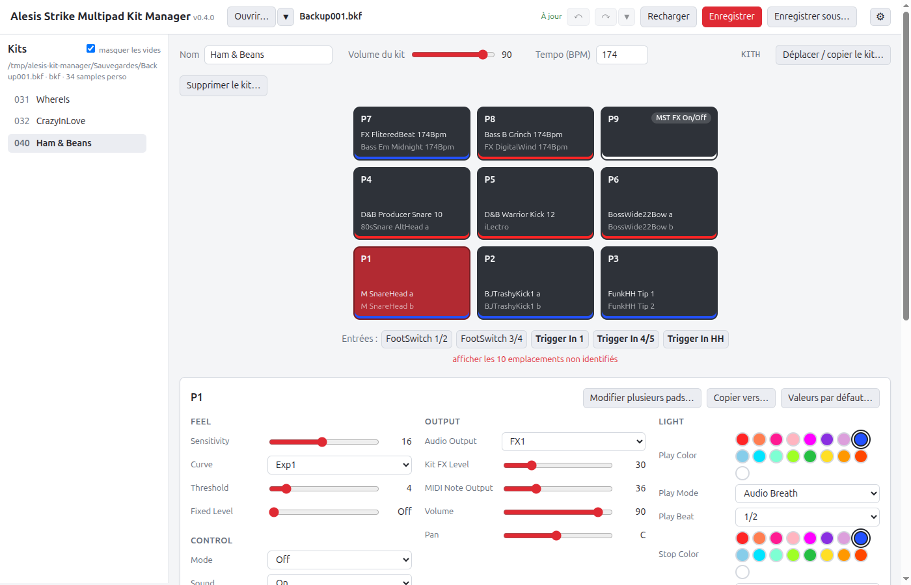
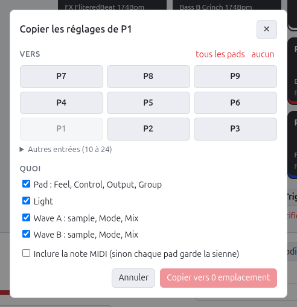
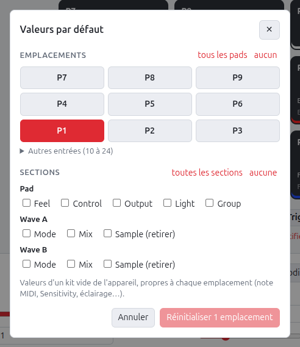
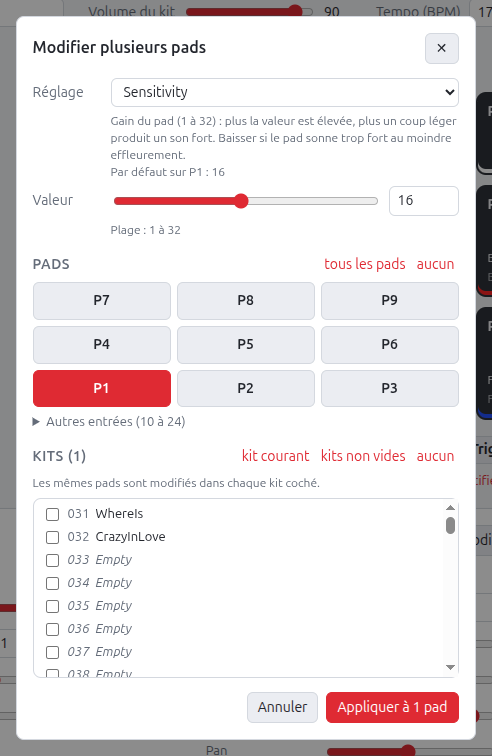
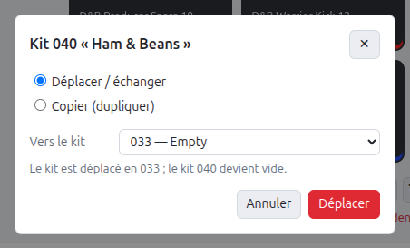
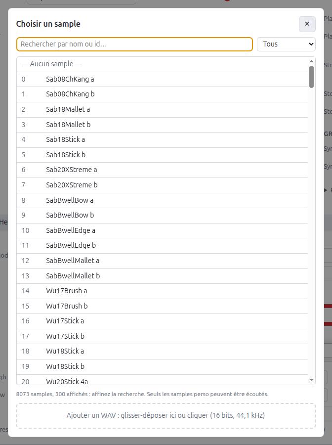
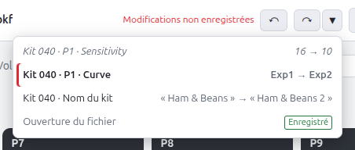
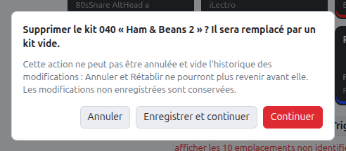
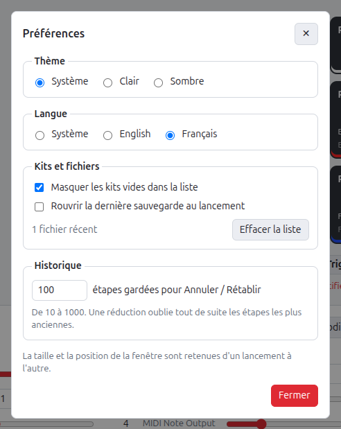

# Éditeur web

[English](../en/web-editor.md) · **Français**

Interface graphique locale (FastAPI + Svelte) pour éditer les kits sans manipuler
de JSON.

## Lancement

Prérequis : Python 3 et Node.js (testé avec Python 3.14 et Node.js 25).

```bash
./dev.sh serve Backups/Backup001.bkf
```

`./dev.sh serve` est le **lancement rapide dans le navigateur**, sans Electron :
l'éditeur y fonctionne dans le même mode que l'application de bureau (jeton,
fichiers désignés par chemin absolu). La sauvegarde `.bkf` ou `.fac` à ouvrir
est obligatoire ; son chemin est relatif au dossier courant.

La commande prépare tout ce qui manque, puis lance le serveur :

1. crée l'environnement virtuel `.venv` s'il n'existe pas ;
2. installe les dépendances de `requirements-dev.txt` (éditeur, tests, outils),
   puis les réinstalle chaque fois que ce fichier ou `requirements.txt` change ;
3. installe les paquets de l'interface (`npm ci`) et la construit dans
   `editor/web/dist`, puis la reconstruit chaque fois qu'une source de
   `editor/web/` est modifiée ;
4. lance `python -m editor --open FICHIER` avec les options reçues.

`./dev.sh start` fait la même préparation pour l'application de bureau.

Variables utiles : `PYTHON=python3.12` choisit l'interpréteur qui crée le venv, et
`REBUILD=1` force la reconstruction de l'interface. Les `.bkf` et `.fac` du
dossier `Backups/` du projet sont ignorés par Git.

| Option | Rôle | Défaut |
|---|---|---|
| `--port N` | port HTTP (`0` : un port libre est choisi) | 8765 |
| `--host ADRESSE` | adresse d'écoute | 127.0.0.1 |
| `--no-browser` | ne pas ouvrir le navigateur | — |
| `--allow DOSSIER` | dossier autorisé en plus de la [zone par défaut](#dossiers-autorisés) (répétable) | — |
| `--watch-stdin` | s'arrêter quand l'entrée standard se ferme (utilisé par l'application de bureau) | — |
| `--version` | afficher la version (`alesis-kit-manager-server X.Y.Z`) et quitter | — |

Le navigateur s'ouvre sur l'adresse affichée, de la forme
`http://127.0.0.1:8765/#token=…`. Le serveur n'écoute que sur la machine locale et
`Ctrl+C` l'arrête.

### Dossiers autorisés

Le serveur n'ouvre et n'enregistre de sauvegarde que dans :

- le dossier personnel de l'utilisateur ;
- ses supports amovibles (clé USB, Strike branché en USB) : sous Linux
  `/media/<utilisateur>` et `/run/media/<utilisateur>`, sous macOS `/Volumes`,
  sous Windows tous les lecteurs sauf celui du système (`D:\`, `E:\`…, même
  branchés après le lancement) ;
- les dossiers ajoutés par `--allow DOSSIER` (`./dev.sh serve FICHIER --allow DOSSIER`).

Les chemins sont résolus avant la vérification : un lien symbolique placé dans le
dossier personnel ne permet pas d'atteindre un fichier extérieur. Un chemin hors
de ces dossiers est refusé (erreur 403, « hors des dossiers autorisés ») ; la
sauvegarde passée au lancement aussi, et le serveur s'arrête alors avec le code 2.
La copie `.bak` étant écrite à côté du fichier ouvert, elle reste dans la zone.
L'application de bureau utilise la zone par défaut.

### Jeton

Chaque requête `/api/*` doit porter l'en-tête `X-KitManager-Token` avec le jeton du
lancement, sinon elle reçoit une erreur 403 : un autre programme de la machine ne
peut donc pas piloter l'éditeur, qui lit et écrit des fichiers.

- **Lancement local** : un jeton est créé à chaque lancement et transmis au
  navigateur dans l'adresse (`#token=…`). L'interface le garde pour l'onglet, ce
  qui permet de recharger la page, et le retire de l'adresse affichée. Une page
  ouverte sans lui affiche « Accès refusé ».
- **Application Electron** : le jeton est donné par la variable d'environnement
  `KITMANAGER_TOKEN`. Une fois à l'écoute, le serveur écrit alors sur sa sortie
  standard une ligne `{"ready": true, "port": N}`, utile avec `--port 0`.

```bash
KITMANAGER_TOKEN=$(openssl rand -hex 16) .venv/bin/python -m editor --port 0 --open "$PWD/Backups/Backup001.bkf"
```

Sans `dev.sh`, l'installation manuelle est la suivante :

```bash
python3 -m venv .venv && .venv/bin/pip install -r requirements.txt
cd editor/web && npm ci && npm run build && cd ../..
.venv/bin/python -m editor --open Backups/Backup001.bkf
```

## Utilisation



1. **Ouvrir** : la sauvegarde passée au lancement est déjà ouverte. Pour en
   ouvrir une autre, saisir son chemin complet en haut, puis cliquer sur *Ouvrir*.
   Dans l'application de bureau, *Ouvrir…* et *Enregistrer sous…* utilisent les
   boîtes de dialogue du système, et seul le nom du fichier ouvert est affiché.
   Le chevron ▾ à côté liste les 10 derniers fichiers ouverts ou enregistrés ;
   dans le navigateur, le champ propose au lancement le dernier d'entre eux.
2. **Choisir un kit** dans la colonne de gauche (les kits vides sont masqués par défaut ; décocher *masquer les vides* pour les voir, par exemple pour y déposer un kit ; ce choix est retenu, voir [Préférences](#préférences)).
3. **Régler le kit** : nom, volume, tempo.
4. **Choisir un pad** dans la grille des 9 pads, disposée comme sur l'appareil (7-8-9 en haut,
   4-5-6 au milieu, 1-2-3 en bas). Elle montre le sample, la couleur de LED et,
   si le pad a un Mode (Control), un badge (« Click » pour Click On/Off). Sous la grille,
   les entrées de l'arrière identifiées (FootSwitch 1/2, FootSwitch 3/4, Trigger In 1,
   4/5, HH, dans cet ordre) ; les autres emplacements (10 à 24) s'affichent par le
   lien *afficher les emplacements non identifiés*.
5. **Régler le pad** :
   - sections du pad, comme sur l'appareil : *Feel* (Sensitivity, Curve, Threshold,
     Fixed Level), *Control* (Mode, Sound), *Output* (Audio Output, Kit FX Level,
     MIDI Note Output, Volume, Pan), *Light* (couleur, mode et beat Play / Stop),
     *Group* (Sync Group, Sync Mode) ; les paramètres non identifiés sont regroupés à part ;
   - *Wave A / Wave B* : sample, puis *Mode* (Playback Mode, Poly/Mono) et *Mix*
     (Volume, Pan, Fade In/Out, Velocity High/Low, Priority).

   Survoler le nom d'un réglage affiche sa description, d'après le manuel, et sa
   valeur par défaut pour le pad affiché. Celle-ci est relevée dans un kit vide
   écrit par l'appareil, et varie pour certains réglages : note MIDI propre à chaque
   emplacement, Sensitivity à 16 sur P1–P6 mais 24 sur les petits pads P7–P9. Pour
   un paramètre non identifié, l'infobulle donne aussi sa plage et, le cas échéant,
   une piste.
6. **Recopier un pad** : *Copier vers…* (en haut des réglages du pad) copie ses
   réglages vers un ou plusieurs autres emplacements. On choisit les sections (pad,
   éclairage, wave A, wave B) et si la note MIDI suit ; par défaut, chaque pad garde
   la sienne. Un champ absent de la cible n'est pas copié et est listé dans le
   message de confirmation.

   

   *Valeurs par défaut…* (à côté) remet des réglages aux valeurs d'un kit vide de
   l'appareil, propres à chaque emplacement (note MIDI, Sensitivity, éclairage…).
   On choisit les emplacements (le pad affiché est présélectionné) et les
   sections : Feel, Control, Output, Light et Group pour le pad, Mode et Mix pour
   chaque wave, *Sample (retirer)* pour retirer aussi le sample. Aucune section
   n'est cochée au départ ; *toutes les sections* les coche toutes, sauf le retrait
   des samples.
   Les paramètres non identifiés ne sont pas touchés.

   

7. **Modifier plusieurs pads** : *Modifier plusieurs pads…* (en haut des réglages
   du pad) donne une même valeur à un réglage sur une sélection de pads, par
   exemple Sensitivity = 20 sur P1, P3, P5 et P9. On choisit le réglage (pad,
   éclairage, vélocité ou mixage d'une wave), la valeur, bornée par sa plage, puis
   les pads. La valeur proposée est celle du pad courant. La section *Kits* permet
   d'appliquer la même valeur aux **mêmes pads de plusieurs kits** (kit courant
   coché par défaut, raccourci *kits non vides*). L'opération est tout ou rien :
   si un kit refuse la valeur, aucun n'est modifié.

   

8. **Déplacer ou dupliquer un kit** : *Déplacer / copier le kit…* (à côté du tempo)
   - *Déplacer / échanger* : le kit va au numéro choisi. Si ce kit est vide, c'est
     un déplacement (le numéro d'origine devient vide) ; sinon les deux kits sont
     échangés ;
   - *Copier (dupliquer)* : une copie du kit remplace le kit choisi, après
     confirmation si celui-ci n'est pas vide.

   Un kit ne contient pas son propre numéro : l'opération recopie ses octets tels
   quels, samples et réglages compris.

   Dans la liste des kits, la poignée ⠿ en bout de ligne (visible au survol d'un
   kit non vide) permet aussi de **réorganiser par glisser-déposer** : le kit
   prend la place du kit sur lequel on le dépose (un trait indique où), et les kits
   d'entre les deux se décalent d'un cran, comme dans une liste.

   

   *Supprimer le kit…* (à côté) remplace le kit, après confirmation, par le kit
   vide écrit par l'appareil : nom « Empty », volume 100, 120 BPM, réglages par
   défaut, aucun sample. Les samples utilisateur restent dans la sauvegarde. Le
   bouton est grisé sur un kit déjà vide.
9. **Choisir un sample** : le bouton du sample ouvre une fenêtre de recherche par nom
   ou par id, avec un filtre *Mes samples / Usine*. Le bouton ▶ écoute un sample
   perso. La zone du bas ajoute un WAV par glisser-déposer
   (voir [Ajouter un sample](adding-a-sample.md)).

   

10. **Enregistrer** écrit dans le fichier ouvert. Au premier enregistrement de
   chaque session sur un fichier d'origine, son état précédent est copié dans
   `<fichier>.N.bak` (`Backup001.bkf.1.bak`, puis `.2.bak` à la session suivante) :
   rien n'est perdu. **Enregistrer sous** écrit dans un autre fichier (le nom
   suivant est proposé, `Backup003.bkf` après `Backup002.bkf`), qui devient le
   fichier ouvert ; si ce fichier existe, une confirmation est demandée.
   **Recharger** relit le fichier ouvert et abandonne toutes les modifications non
   enregistrées, après confirmation s'il y en a ; le kit affiché reste le même.
11. **Annuler / Rétablir** : boutons ↶ ↷ et liste ▾ de l'en-tête (voir ci-dessous).

Chaque modification est envoyée au serveur et validée aussitôt. Une valeur refusée
(hors plage, par exemple) affiche un message et le kit revient à son dernier état
valide. Les modifications restent en mémoire jusqu'à *Enregistrer*. Le
navigateur prévient si l'on quitte la page avec des modifications non enregistrées.

Charger ensuite le fichier produit sur l'appareil comme décrit dans
[Modifier un kit](editing-a-kit.md#5-charger-sur-lappareil).

### Annuler / Rétablir

Les boutons ↶ et ↷ de l'en-tête annulent et rétablissent les modifications de
paramètres, une action à la fois ; leur infobulle et le message affiché nomment
l'action (« Kit 032 · P1 · Volume », « Sensitivity · 3 kits »).

Le chevron ▾ à côté affiche l'**historique** : les actions de la plus récente à
la plus ancienne, avec l'ancienne et la nouvelle valeur quand une action ne
modifie qu'un paramètre (« 90 → 50 », « Normal → Exp2 »). La position actuelle
est marquée ; les actions annulées, encore rétablissables, sont grisées au-dessus ;
le repère *Enregistré* indique l'état du dernier enregistrement. Un clic sur une
ligne y revient en une fois (en annulant ou en rétablissant les actions d'entre
les deux) ; la dernière ligne, *Ouverture du fichier* (ou *Début de
l'historique* quand l'historique a été vidé), annule tout.



- **Raccourcis** : `Ctrl+Z` annule, `Ctrl+Y` ou `Ctrl+Maj+Z` rétablit (`Cmd` sous
  macOS) ; dans l'application de bureau, aussi *Édition › Annuler / Rétablir*.
  Dans un champ de saisie (nom du kit, valeur), ils annulent la frappe, comme
  partout ; une fois hors du champ, ils annulent les modifications.
- **Une étape par action** : un réglage modifié, une copie de réglages, des
  valeurs par défaut, une modification de plusieurs pads ou de plusieurs kits.
  Les changements rapprochés d'un même réglage (curseur que l'on fait glisser,
  nom que l'on tape) ne font qu'une étape.
- **Hors historique** : déplacer, transférer (copier, échanger) ou supprimer un
  kit remplace des kits entiers et vide l'historique. S'il reste des actions à
  annuler ou à rétablir, une alerte propose *Annuler* (renoncer à l'action),
  *Enregistrer et continuer* ou *Continuer* ; les modifications non enregistrées
  sont conservées dans tous les cas. L'ajout d'un sample ne s'annule pas non plus,
  mais garde l'historique : le sample reste dans la sauvegarde.

  

- **État enregistré** : annuler jusqu'au dernier enregistrement réaffiche « À jour ».
  Ouvrir un fichier ou *Recharger* vide l'historique.
- **Taille** : les 100 dernières actions par défaut ; les plus anciennes sont
  oubliées. La taille se règle de 10 à 1000 dans les [Préférences](#préférences).

### Préférences

Le bouton ⚙ en haut à droite (dans l'application de bureau, aussi *Édition ›
Préférences…*, `Ctrl+,` ; sous macOS, dans le menu de l'application) ouvre la
fenêtre des préférences. Chaque réglage s'applique et s'enregistre aussitôt :



| Préférence | Par défaut | Effet |
|---|---|---|
| Thème | Système | *Clair* ou *Sombre* fixe le thème ; *Système* suit le réglage du système |
| Langue | Système | *English* ou *Français* : langue de l'interface, des menus et boîtes de dialogue de l'application de bureau, et des messages du serveur (erreurs, historique, infobulles) ; *Système* suit la langue du système (français s'il est en français, anglais sinon). Les noms et valeurs des paramètres des pads restent en anglais, comme sur l'appareil |
| Masquer les kits vides | oui | même réglage que *masquer les vides* au-dessus de la liste des kits |
| Rouvrir la dernière sauvegarde au lancement | non | sans fichier passé au lancement, rouvre le plus récent des fichiers récents (rien s'il n'est plus lisible) |
| Fichiers récents | — | les 10 derniers fichiers ouverts ou enregistrés sous un autre nom ; *Effacer la liste* les oublie |
| Taille de l'historique | 100 | étapes gardées pour [Annuler / Rétablir](#annuler--rétablir), de 10 à 1000 ; une réduction oublie tout de suite les plus anciennes |

Le dossier du dernier fichier ouvert est aussi retenu : la boîte « Ouvrir » de
l'application de bureau s'y ouvre. L'application de bureau retient en plus la
taille, la position et l'état maximisé de sa fenêtre (voir
[Application de bureau](desktop-app.md#fonctionnement)).

Les préférences sont gérées par le serveur, communes au navigateur et à
l'application de bureau, dans `preferences.json` (module `editor/preferences.py`) :

| Système | Dossier |
|---|---|
| Linux | `~/.config/AlesisKitManager/` (ou `$XDG_CONFIG_HOME/AlesisKitManager/`) |
| macOS | `~/Library/Application Support/AlesisKitManager/` |
| Windows | `%APPDATA%\AlesisKitManager\` |

La variable d'environnement `KITMANAGER_CONFIG` désigne un autre dossier (les
tests s'en servent pour ne pas toucher aux préférences de l'utilisateur). Un
fichier illisible, ou une valeur invalide, est ignoré : la valeur par défaut
s'applique.

## API

Le serveur expose une API JSON, utilisable aussi depuis un script ; chaque requête
porte l'en-tête `X-KitManager-Token`, et les chemins de fichiers sont absolus.
L'en-tête `X-KitManager-Language` (`en` ou `fr`, anglais par défaut) choisit la
langue des messages d'erreur, des libellés de l'historique et des infobulles :

| Méthode | Route | Rôle |
|---|---|---|
| POST | `/api/open` | ouvrir une sauvegarde (`{"path": "/chemin/absolu", "force": false}`) ; 403 hors des [dossiers autorisés](#dossiers-autorisés) ; 409 si des modifications ne sont pas enregistrées, sauf `force` |
| GET | `/api/state` | sauvegarde ouverte, liste des kits, modifications en attente, `history` : libellés des actions à annuler et à rétablir (`{"undo": …, "redo": …}`, `null` s'il n'y en a pas) |
| GET | `/api/meta` | description des paramètres (plages, libellés, couleurs) |
| GET / PUT | `/api/kits/{num}` | lire / modifier un kit (même JSON que l'export) |
| POST | `/api/kits/set` | même chose dans plusieurs kits, tout ou rien (`{"kits": ["031", "032"], "targets": [1, 9], "field": "params.sensitivity", "value": 20}`) ; renvoie l'état et les champs absents |
| POST | `/api/kits/{num}/set` | même valeur pour un champ de plusieurs emplacements (`{"targets": [1, 3, 5], "field": "params.sensitivity", "value": 20}` ; champs : `params.*`, `light.*`, `wave_a.*` / `wave_b.*` dont `sample` et les vélocités, `wave_a.params.*` / `wave_b.params.*`) |
| POST | `/api/kits/{num}/reset` | remettre des champs d'emplacements aux valeurs du kit vide de l'appareil (`{"targets": [1, 2], "fields": ["params.curve", "wave_a.sample"]}`) ; renvoie le kit, les champs non modifiés et `history` (comme `/set` et `/copy`) |
| POST | `/api/kits/{num}/move` | déplacer le kit au numéro `{"target": "033"}` ; les kits entre les deux numéros se décalent d'un cran ; renvoie l'état |
| POST | `/api/kits/{num}/clear` | supprimer le kit : le remplacer par le kit vide de l'appareil ; renvoie l'état |
| POST | `/api/kits/{num}/transfer` | copier le kit vers un autre numéro (`{"target": "040", "mode": "copy"}`) ou échanger les deux kits (`"mode": "swap"`) ; renvoie l'état |
| POST | `/api/kits/{num}/copy` | recopier un emplacement (`{"source": 9, "targets": [7, 8], "parts": ["params", "light", "wave_a", "wave_b"], "include_midi_note": false}`) |
| GET | `/api/samples` | catalogue des samples |
| GET | `/api/samples/{id}/wav` | WAV d'un sample utilisateur |
| POST | `/api/samples` | ajouter un WAV (formulaire multipart, champ `file`) |
| POST | `/api/undo` / `/api/redo` | annuler / rétablir la dernière action de l'historique ; renvoie l'état, `done` (libellé de l'action), `detail` (« 90 → 50 », vide si l'action modifie plusieurs paramètres) et `changed` (kits modifiés) ; 409 s'il n'y a rien à annuler ou à rétablir |
| GET | `/api/history` | actions de l'historique, de la plus ancienne à la plus récente (`entries` : `id`, `label`, `detail`, `done` faite ou annulée) ; `base` : id de l'état avant la plus ancienne, `position` : dernière action faite, `saved` : action du dernier enregistrement (`null` si l'état enregistré n'est plus atteignable) |
| POST | `/api/history/goto` | revenir à une action (`{"id": 12}`, ou `base` pour tout annuler) ; renvoie l'état et `changed` ; 404 si l'action n'est pas dans l'historique |
| GET / PATCH | `/api/preferences` | lire / modifier les [préférences](#préférences) (`{"theme": "dark", "history_limit": 200}` ; clés : `theme`, `hide_empty`, `reopen_last`, `history_limit`, `recent_files`, `last_dir`) ; 400 si une clé ou une valeur est invalide, rien n'est alors modifié |
| POST | `/api/save` | `{}` : enregistrer dans le fichier ouvert (copie `.N.bak` de l'original au premier enregistrement de la session) ; `{"path": …, "overwrite": false}` : enregistrer sous (403 hors des dossiers autorisés ; 409 si un autre fichier existe, sauf `overwrite`) |

La documentation interactive est disponible sur http://127.0.0.1:8765/docs ; ses
appels de test demandent d'ajouter l'en-tête du jeton.

## Développement de l'interface

Pour profiter du rechargement à chaud :

```bash
./dev.sh serve Backups/Backup001.bkf --no-browser   # serveur API ; noter le jeton affiché
cd editor/web && npm run dev                        # puis ouvrir http://localhost:5173/#token=…
```

Vite relaie `/api` vers le serveur ; le jeton affiché au lancement du serveur est
à ajouter à l'adresse de Vite. Voir aussi [Développement](development.md).

### Mode bureau

L'interface passe en mode bureau quand l'application Electron expose l'objet
`window.kitManagerDesktop` (preload) ; le même code sert aux deux modes.

| Membre | Rôle |
|---|---|
| `token` | jeton du serveur, envoyé dans l'en-tête `X-KitManager-Token` |
| `openFile(defaultDir)` | boîte native « Ouvrir », dans le dossier du dernier fichier ouvert ; renvoie une promesse du chemin absolu choisi, ou `null` |
| `saveFile(defaultPath)` | boîte native « Enregistrer sous », ouverte sur le nom suivant ; renvoie le chemin ou `null`. La boîte confirme elle-même l'écrasement d'un fichier existant |
| `setDirty(dirty)` | appelé à chaque changement de l'état « modifications non enregistrées », pour que l'application confirme la fermeture de la fenêtre |
| `setRecent(files)` | fichiers récents, pour le menu *Fichier › Ouvrir récent* |
| `setLanguage(lang)` | langue de l'interface (`en` ou `fr`), pour les menus et boîtes de dialogue de l'application |
| `onCommand(handler)` | reçoit les commandes de l'application, `{ command, path? }` ; la valeur renvoyée par `handler` est la réponse : `open`, `save`, `save-as` (menu Fichier), `open-file` (fichier passé au lancement, ou fichier récent), `preferences` (fenêtre Préférences), `clear-recent` (effacer les fichiers récents), `prepare-close` (→ `{ dirty }`, après envoi des modifications en attente), `save-before-close` (→ `{ saved }`) |

En mode bureau, l'interface ne bloque pas la fermeture de la page
(`beforeunload`) : c'est l'application qui la confirme.

Pour essayer ce mode dans le navigateur, sans Electron, un bouchon remplace les
boîtes natives par des `prompt()` : avec `npm run dev`, ajouter `&desktop=fake`
à l'adresse (`http://localhost:5173/#token=…&desktop=fake`). Il reste actif pour
l'onglet, journalise `setDirty` dans la console, marque le titre de la page
d'un « ● », et les commandes s'envoient depuis la console
(`await kitManagerFakeCommand("prepare-close")`). Il n'existe qu'en développement et n'est pas inclus dans le build.
